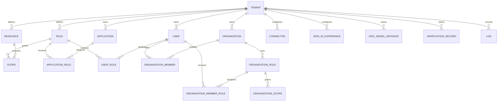

# Logto 源码领域模型整理

> 研究对象：`logto-io/logto` 的 `master` 分支源码。本文记录的是 Logto 当前源码中的数据库 schema、JSONB 类型和部分 API 类型，不是对 Roseto 的设计建议，也不保证不同 Logto 版本保持字段兼容。
>
> 许可证：Logto 仓库标注 MPL-2.0。本文只记录字段、关系和源码路径，不复制实现代码。

文档导航：[文档总索引](README.md)。

阅读顺序：先读本文理解表和关系，再读 [`logto-user-flow.md`](logto-user-flow.md) 了解业务流程，最后读 [`logto-api-flow.md`](logto-api-flow.md) 追踪接口调用链。

## 1. 先读这份文档的方法

Logto 的“领域模型”不是一组纯粹的 JavaScript/TypeScript class，主要由三层组成：

1. `packages/schemas/tables/*.sql`：PostgreSQL 表、枚举、主键、外键、唯一约束、索引。
2. `packages/schemas/src/foundations/jsonb-types/*.ts`：存储在 JSONB 列中的结构化对象。
3. `packages/schemas/src/types/*.ts`：数据库模型的 API guard、DTO 和应用侧组合类型。

因此下面会明确标注：

- **SQL 字段**：数据库直接存储的列；
- **JSONB 字段**：列存在，但内部结构由 TypeScript 类型约束；
- **API 类型**：不一定对应单独的数据库表或列。

Logto 的核心隔离键是 `tenant_id`。大多数业务表都把 `tenant_id` 作为第一列，并通过 tenant 外键、复合外键或 tenant-scoped unique index 防止跨租户引用。

## 2. 总体关系

图中 `ORGANIZATION_ROLE` 和 `ORGANIZATION_SCOPE` 的注释明确表示它们由 organization template 定义，但当前 schema 中没有独立的 `organization_templates` 表。所谓 template 更接近 tenant 级的组织角色 / 组织 scope 配置集合。

## 3. 实体与字段

### 3.1 Tenant

源码：

- [`packages/schemas/src/models/tenants.ts`](https://github.com/logto-io/logto/blob/master/packages/schemas/src/models/tenants.ts)

| 字段 | SQL 类型 | 约束 / 含义 |
|---|---|---|
| `id` | `varchar(21)` | PK；其他业务表的租户外键 |
| `db_user` | `varchar(128)` | 可空；唯一；租户数据库用户相关字段 |
| `db_user_password` | `varchar(128)` | 可空 |
| `name` | `varchar(128)` | 非空，默认 `My Project` |
| `tag` | `varchar(64)` | 非空，默认 development；映射 `TenantTag` 枚举 |
| `created_at` | `timestamptz` | 非空，默认当前时间 |
| `is_suspended` | `boolean` | 非空，默认 `false` |

源码：[`packages/schemas/src/models/tenants.ts`](https://github.com/logto-io/logto/blob/master/packages/schemas/src/models/tenants.ts)。

### 3.2 User

源码：[`packages/schemas/tables/users.sql`](https://github.com/logto-io/logto/blob/master/packages/schemas/tables/users.sql)。

| 字段 | SQL 类型 | 约束 / 含义 |
|---|---|---|
| `tenant_id` | `varchar(21)` | 非空，FK → `tenants.id`，级联删除 |
| `id` | `varchar(12)` | PK；源码另建 `(tenant_id, id)` unique index 供复合外键使用 |
| `username` | `varchar(128)` | 可空；`(tenant_id, username)` 唯一 |
| `primary_email` | `varchar(128)` | 可空；`(tenant_id, primary_email)` 唯一 |
| `primary_phone` | `varchar(128)` | 可空；`(tenant_id, primary_phone)` 唯一 |
| `password_encrypted` | `varchar(256)` | 可空；密码摘要 |
| `password_encryption_method` | enum | `Argon2i`、`Argon2id`、`Argon2d`、`SHA1`、`SHA256`、`MD5`、`Bcrypt`、`Legacy` |
| `name` | `varchar(128)` | 可空 |
| `avatar` | `varchar(2048)` | 可空；映射 OIDC `picture` claim |
| `profile` | `jsonb` | `UserProfile`；额外 OIDC 标准 claims |
| `application_id` | `varchar(21)` | 可空；与应用创建用户场景相关 |
| `cimd_client_id` | `varchar(2048)` | 可空 |
| `identities` | `jsonb` | `Identities`；社会化 / 外部身份集合 |
| `custom_data` | `jsonb` | `JsonObject`；用户自定义数据 |
| `logto_config` | `jsonb` | `JsonObject`；Logto 内部配置 |
| `mfa_verifications` | `jsonb` | `MfaVerifications` 数组 |
| `is_suspended` | `boolean` | 非空，默认 `false` |
| `is_password_expired` | `boolean` | 非空，默认 `false` |
| `last_sign_in_at` | `timestamptz` | 可空 |
| `password_updated_at` | `timestamptz` | 可空 |
| `created_at` / `updated_at` | `timestamptz` | 创建和更新时间 |

源码中的唯一性是 **tenant-scoped**：同一 Tenant 内 username、primary email、primary phone 不重复；不能据此推断跨 Tenant 全局唯一。

JSONB 类型的来源：

- [`packages/schemas/src/foundations/jsonb-types/users.ts`](https://github.com/logto-io/logto/blob/master/packages/schemas/src/foundations/jsonb-types/users.ts)

### 3.3 User SSO Identity

源码：[`packages/schemas/tables/user_sso_identities.sql`](https://github.com/logto-io/logto/blob/master/packages/schemas/tables/user_sso_identities.sql)。

| 字段 | SQL 类型 | 约束 / 含义 |
|---|---|---|
| `tenant_id` | `varchar(21)` | FK → tenant |
| `id` | `varchar(21)` | PK |
| `user_id` | `varchar(12)` / 源码引用处为 `varchar(21)` | FK → user |
| `issuer` | `varchar(256)` | 外部 provider 的 issuer / SAML entityId |
| `identity_id` | `varchar(128)` | 外部 provider 中的用户身份标识 |
| `detail` | `jsonb` | 外部身份详情 |
| `sso_connector_id` | `varchar(128)` | FK → `sso_connectors.id` |
| `created_at` / `updated_at` | timestamp | 创建和更新时间 |

唯一约束：`(tenant_id, issuer, identity_id)`。这说明外部身份绑定在 Tenant 内唯一，而不是 Logto 全局唯一。

### 3.4 Application

源码：[`packages/schemas/tables/applications.sql`](https://github.com/logto-io/logto/blob/master/packages/schemas/tables/applications.sql)。

| 字段 | SQL 类型 | 约束 / 含义 |
|---|---|---|
| `tenant_id` | `varchar(21)` | FK → tenant |
| `id` | `varchar(21)` | PK |
| `name` | `varchar(256)` | 非空 |
| `secret` | `varchar(64)` | 旧的内部 client secret 字段；源码标记 deprecated |
| `description` | `text` | 可空 |
| `type` | enum | `Native`、`SPA`、`Traditional`、`MachineToMachine`、`Protected`、`SAML` |
| `oidc_client_metadata` | `jsonb` | `OidcClientMetadata` |
| `custom_client_metadata` | `jsonb` | `CustomClientMetadata` |
| `protected_app_metadata` | `jsonb` | `ProtectedAppMetadata` |
| `custom_data` | `jsonb` | `JsonObject` |
| `is_third_party` | `boolean` | 默认 `false` |
| `app_level_access_control_enabled` | `boolean` | 默认 `false` |
| `created_at` | `timestamptz` | 创建时间 |

Application 的 OIDC redirect URI、grant type、token endpoint auth method 等主要进入 `oidc_client_metadata` JSONB，而不是全部展开成 SQL 列。应用 secrets 另有表：

- [`packages/schemas/tables/application_secrets.sql`](https://github.com/logto-io/logto/blob/master/packages/schemas/tables/application_secrets.sql)

`application_secrets` 字段：`tenant_id`、`application_id`、`name`、`value`、`created_at`、`expires_at`；主键为 `(tenant_id, application_id, name)`，仅允许 MachineToMachine、Traditional、Protected 类型。

### 3.5 Resource

源码：[`packages/schemas/tables/resources.sql`](https://github.com/logto-io/logto/blob/master/packages/schemas/tables/resources.sql)。

| 字段 | SQL 类型 | 约束 / 含义 |
|---|---|---|
| `tenant_id` | `varchar(21)` | FK → tenant |
| `id` | `varchar(21)` | PK |
| `name` | `text` | 非空 |
| `indicator` | `text` | 非空；也是 resource indicator / audience |
| `is_default` | `boolean` | 每个 Tenant 最多一个默认 Resource |
| `access_token_ttl` | `bigint` | 秒数，默认 3600 |

唯一约束：`(tenant_id, indicator)`；部分唯一索引保证每个 Tenant 只有一个 `is_default = true`。

### 3.6 Scope

源码：[`packages/schemas/tables/scopes.sql`](https://github.com/logto-io/logto/blob/master/packages/schemas/tables/scopes.sql)。

| 字段 | SQL 类型 | 约束 / 含义 |
|---|---|---|
| `tenant_id` | `varchar(21)` | FK → tenant |
| `id` | `varchar(21)` | PK，并有 `(tenant_id, id)` unique index |
| `resource_id` | `varchar(21)` | FK → resource |
| `name` | `varchar(256)` | scope 名称 |
| `description` | `text` | 可空 |
| `created_at` | `timestamptz` | 创建时间 |

唯一约束：`(tenant_id, resource_id, name)`。

### 3.7 Global Role

源码：[`packages/schemas/tables/roles.sql`](https://github.com/logto-io/logto/blob/master/packages/schemas/tables/roles.sql)。

| 字段 | SQL 类型 | 约束 / 含义 |
|---|---|---|
| `tenant_id` | `varchar(21)` | FK → tenant |
| `id` | `varchar(21)` | PK |
| `name` | `varchar(128)` | `(tenant_id, name)` 唯一 |
| `description` | `varchar(128)` | 非空 |
| `type` | enum | `User` 或 `MachineToMachine` |
| `is_default` | `boolean` | 新用户默认角色；M2M role 忽略 |

Role 与 Scope 是多对多关系：

- [`roles_scopes.sql`](https://github.com/logto-io/logto/blob/master/packages/schemas/tables/roles_scopes.sql)
- [`users_roles.sql`](https://github.com/logto-io/logto/blob/master/packages/schemas/tables/users_roles.sql)
- [`applications_roles.sql`](https://github.com/logto-io/logto/blob/master/packages/schemas/tables/applications_roles.sql)

`roles_scopes` 把 role 和 scope 关联；`users_roles` 把 User 与 User role 关联；`applications_roles` 把 M2M Application 与 M2M role 关联。角色类型通过数据库函数约束关联对象类型。

### 3.8 Organization

源码：[`packages/schemas/tables/organizations.sql`](https://github.com/logto-io/logto/blob/master/packages/schemas/tables/organizations.sql)。

| 字段 | SQL 类型 | 约束 / 含义 |
|---|---|---|
| `tenant_id` | `varchar(21)` | FK → tenant |
| `id` | `varchar(21)` | PK；注释称 globally unique identifier |
| `name` | `varchar(128)` | 展示名称 |
| `description` | `varchar(256)` | 可空 |
| `custom_data` | `jsonb` | 组织自定义数据 |
| `is_mfa_required` | `boolean` | 是否要求组织成员 MFA |
| `is_trusted_device_allowed` | `boolean` | 是否允许 trusted device，默认 true |
| `color` | `jsonb` | `PartialColor` |
| `branding` | `jsonb` | `Branding` |
| `custom_css` | `text` | 可空 |
| `created_at` | `timestamptz` | 创建时间 |

### 3.9 Organization Member

源码：[`packages/schemas/tables/organization_user_relations.sql`](https://github.com/logto-io/logto/blob/master/packages/schemas/tables/organization_user_relations.sql)。

该表没有独立的 member entity，membership 由关联表表达：

| 字段 | SQL 类型 | 约束 / 含义 |
|---|---|---|
| `tenant_id` | `varchar(21)` | FK → tenant |
| `organization_id` | `varchar(21)` | FK → organization |
| `user_id` | `varchar(21)` | FK → user |

主键：`(tenant_id, organization_id, user_id)`。

复合外键 `(tenant_id, user_id)` → `users(tenant_id, id)`，因此 Logto 在数据库层显式防止把一个 Tenant 的 User 连接到另一个 Tenant 的 Organization。

### 3.10 Organization Role / Scope

源码：

- [`organization_roles.sql`](https://github.com/logto-io/logto/blob/master/packages/schemas/tables/organization_roles.sql)
- [`organization_scopes.sql`](https://github.com/logto-io/logto/blob/master/packages/schemas/tables/organization_scopes.sql)
- [`organization_role_user_relations.sql`](https://github.com/logto-io/logto/blob/master/packages/schemas/tables/organization_role_user_relations.sql)
- [`organization_role_scope_relations.sql`](https://github.com/logto-io/logto/blob/master/packages/schemas/tables/organization_role_scope_relations.sql)

`organization_roles` 字段：

- `tenant_id`
- `id`
- `name`
- `description`
- `type`：复用 `role_type`，`User` / `MachineToMachine`

`organization_scopes` 字段：

- `tenant_id`
- `id`
- `name`
- `description`

组织 role / scope 的唯一名称约束均为 Tenant 级。组织角色与用户的关系由 `organization_role_user_relations` 表达，主键为 `(tenant_id, organization_id, organization_role_id, user_id)`，并且复合外键要求该 User 已经是该 Organization 的成员。

组织 role 与 organization scope 的关系由 `organization_role_scope_relations` 表达，主键为 `(tenant_id, organization_role_id, organization_scope_id)`。

源码注释把 `organization_roles` 和 `organization_scopes` 描述为由 organization template 定义，但当前 schema 目录没有独立的 `organization_templates` 表。实现上应把 template 理解为一组 Tenant-scoped 的组织角色和组织 scope 配置，而不是擅自增加一张 Logto 同名表。

### 3.11 Connector

源码：[`packages/schemas/tables/connectors.sql`](https://github.com/logto-io/logto/blob/master/packages/schemas/tables/connectors.sql)。

| 字段 | SQL 类型 | 约束 / 含义 |
|---|---|---|
| `tenant_id` | `varchar(21)` | FK → tenant |
| `id` | `varchar(128)` | PK |
| `sync_profile` | `boolean` | 是否同步外部 profile，默认 false |
| `enable_token_storage` | `boolean` | OAuth2/OIDC social connector 的 token storage 开关 |
| `connector_id` | `varchar(128)` | connector 类型 / provider 标识 |
| `config` | `jsonb` | `JsonObject`；连接器配置 |
| `metadata` | `jsonb` | `ConfigurableConnectorMetadata` |
| `created_at` | `timestamptz` | 创建时间 |

Connector 的外部用户绑定不直接改写 User 主表，而通过 `user_sso_identities` 或 identities JSONB 建立身份关联。

### 3.12 Sign-in Experience

源码：[`packages/schemas/tables/sign_in_experiences.sql`](https://github.com/logto-io/logto/blob/master/packages/schemas/tables/sign_in_experiences.sql)。

这是一个 Tenant 级配置实体，主键为 `(tenant_id, id)`。主要 SQL 字段分为：

| 分组 | 字段 |
|---|---|
| 品牌与语言 | `color`、`branding`、`hide_logto_branding`、`language_info`、`custom_css`、`custom_content`、`custom_ui_assets`、`custom_ui_csp` |
| 条款 | `terms_of_use_url`、`privacy_policy_url`、`agree_to_terms_policy` |
| 登录注册 | `sign_in`、`sign_up`、`sign_in_mode`、`sign_up_profile_fields` |
| 外部身份 | `social_sign_in`、`social_sign_in_connector_targets`、`single_sign_on_enabled` |
| 密码与 MFA | `password_policy`、`mfa`、`adaptive_mfa`、`passkey_sign_in`、`password_expiration` |
| 设备与验证码 | `trusted_device`、`captcha_policy`、`sentinel_policy`、`verification_code_policy` |
| 账户恢复 | `forgot_password_methods` |
| 用户名 | `username_policy` |
| 支持信息 | `support_email`、`support_website_url`、`unknown_session_redirect_url` |

枚举：

- `sign_in_mode`：`SignIn`、`Register`、`SignInAndRegister`
- `agree_to_terms_policy`：`Automatic`、`ManualRegistrationOnly`、`Manual`

JSONB 具体结构由 `packages/schemas/src/foundations/jsonb-types/` 下相应类型定义，而不是由上述 SQL 表直接展开。

### 3.13 OIDC Model Instance

源码：[`packages/schemas/tables/oidc_model_instances.sql`](https://github.com/logto-io/logto/blob/master/packages/schemas/tables/oidc_model_instances.sql)。

Logto 没有为每个 OAuth/OIDC 临时对象都建立独立表，而使用通用存储：

| 字段 | SQL 类型 | 约束 / 含义 |
|---|---|---|
| `tenant_id` | `varchar(21)` | FK → tenant |
| `model_name` | `varchar(64)` | 例如 Session、Grant 等 model 名称 |
| `id` | `varchar(128)` | PK |
| `payload` | `jsonb` | `OidcModelInstancePayload` |
| `expires_at` | `timestamptz` | 到期时间 |
| `consumed_at` | `timestamptz` | 一次性对象消费时间，可空 |

唯一约束：`(tenant_id, model_name, id)`。源码还对 payload 中的 `userCode`、`uid`、`grantId`、`accountId` 建立 tenant-aware 索引。

因此 authorization code、grant、session、token 的实际字段需要结合 `payload` 类型和 OIDC provider 使用方式解释，不能简单假设每一个都是独立 SQL 表。

### 3.14 Verification Record

源码：[`packages/schemas/tables/verification_records.sql`](https://github.com/logto-io/logto/blob/master/packages/schemas/tables/verification_records.sql)。

| 字段 | SQL 类型 | 约束 / 含义 |
|---|---|---|
| `tenant_id` | `varchar(21)` | FK → tenant |
| `id` | `varchar(21)` | PK |
| `user_id` | `varchar(21)` | 可空，FK → user |
| `created_at` | `timestamptz` | 创建时间 |
| `expires_at` | `timestamptz` | 到期时间 |
| `data` | `jsonb` | `JsonObject`；具体 verification class 负责校验 |

Verification 的具体业务类型没有在该表中用 SQL enum 固定，而是放入 `data` 并由应用层验证。

### 3.15 Audit / Log

源码：[`packages/schemas/tables/logs.sql`](https://github.com/logto-io/logto/blob/master/packages/schemas/tables/logs.sql)。

| 字段 | SQL 类型 | 约束 / 含义 |
|---|---|---|
| `tenant_id` | `varchar(21)` | FK → tenant |
| `id` | `varchar(21)` | PK |
| `key` | `varchar(128)` | 日志事件 key |
| `payload` | `jsonb` | `LogContextPayload` |
| `created_at` | `timestamptz` | 创建时间 |

源码为 `payload.userId`、`payload.applicationId`、`payload.hookId` 和创建时间建立 tenant-scoped 索引。日志表是 Tenant 内的事件记录，不等同于完整的审计领域模型。

## 4. 关系汇总

| 关系 | 实现方式 |
|---|---|
| Tenant → User | `users.tenant_id` FK |
| Tenant → Application | `applications.tenant_id` FK |
| Tenant → Resource | `resources.tenant_id` FK |
| Resource → Scope | `scopes.resource_id` FK；scope 名称在 `(tenant, resource)` 内唯一 |
| Role ↔ Scope | `roles_scopes` 多对多 |
| User ↔ Global Role | `users_roles` 多对多 |
| M2M Application ↔ Role | `applications_roles` 多对多，并检查 role type |
| Tenant → Organization | `organizations.tenant_id` FK |
| User ↔ Organization | `organization_user_relations`，复合主键和复合 tenant FK |
| Organization Role ↔ User | `organization_role_user_relations`，同时要求用户已是成员 |
| Organization Role ↔ Organization Scope | `organization_role_scope_relations` |
| Tenant → Connector | `connectors.tenant_id` FK |
| User ↔ External SSO identity | `user_sso_identities`，`(tenant, issuer, identity_id)` 唯一 |
| Tenant → Sign-in Experience | `sign_in_experiences` 的复合主键 `(tenant_id, id)` |
| Tenant → OIDC transient state | `oidc_model_instances.tenant_id` |
| Tenant → Verification | `verification_records.tenant_id` |
| Tenant → Log | `logs.tenant_id` |

## 5. 对 Roseto 的直接启发

### 可以借鉴

1. 所有主要业务表显式带 `tenant_id`。
2. 跨 Tenant 的 User / Organization 关系通过复合外键在数据库层阻断。
3. Resource indicator 同时作为 audience，scope 从属于 resource。
4. Global Role、M2M Role、Organization Role 有不同的关联表和类型约束。
5. Connector、Sign-in Experience、User profile 等可变结构适合 JSONB + 类型 guard。
6. OIDC 临时对象使用带 TTL、消费状态和 payload 的通用存储，避免为每个协议对象过早固化表结构。
7. Organization membership 是关系本身；组织角色分配还要再次验证 membership 存在。

### 不应直接照搬

1. Logto 的 `Tenant` 是其产品实例 / 项目隔离模型，不能直接推导 Roseto 的 `PlatformAccount`、TenantMembership 或 Console 管理身份。
2. `users.identities`、`profile`、`custom_data` 的 JSONB 形态应结合 Roseto 的审计、加密和查询需求重新设计。
3. `oidc_model_instances.payload` 是 Logto 当前 provider 持久化策略，不等于 Roseto 必须把 authorization code、grant、session、token 全部放入一个 JSONB 表。
4. 组织 template 在当前源码中通过 organization roles / scopes 配置体现，没有发现独立 `organization_templates` 表；Roseto 是否建立显式模板实体应作为自己的设计决定。
5. `applications.secret` 已被源码注释标记为 deprecated；新系统不应复制这个旧字段语义，应使用独立的 secret / key material 管理。

## 6. 源码边界与版本风险

- 本文基于 GitHub `master` 源码路径，未将某个 commit 锁定为 Roseto 的永久依赖合同。
- SQL schema 是最强字段和关系证据；API DTO / guard 可能只暴露字段子集或组合多个表。
- JSONB 类型需要继续读取对应 `foundations/jsonb-types` 文件才能得到完整嵌套字段；本文对这些字段保留了类型名，不将未展开结构伪装成完整 schema。
- Logto 的 SQL 表、TypeScript guards 和 API 行为可能随版本演进；如果 Roseto 需要精确兼容，应在引用时记录具体 commit SHA。

## 7. 主要源码入口

- Schema 根目录：<https://github.com/logto-io/logto/tree/master/packages/schemas>
- SQL tables：<https://github.com/logto-io/logto/tree/master/packages/schemas/tables>
- DB models：<https://github.com/logto-io/logto/tree/master/packages/schemas/src/models>
- JSONB types：<https://github.com/logto-io/logto/tree/master/packages/schemas/src/foundations/jsonb-types>
- Schema types / API guards：<https://github.com/logto-io/logto/tree/master/packages/schemas/src/types>
- License：<https://github.com/logto-io/logto/blob/master/LICENSE>
