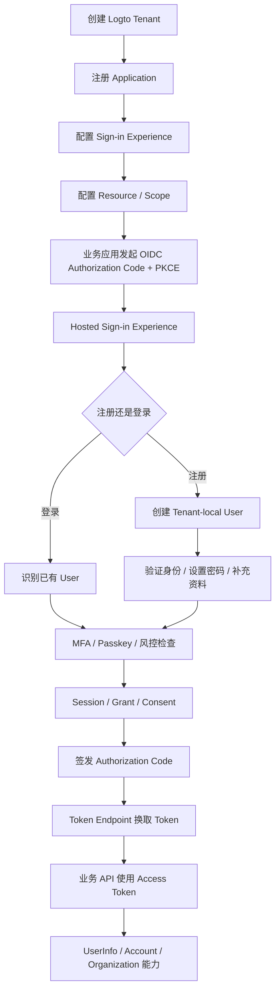
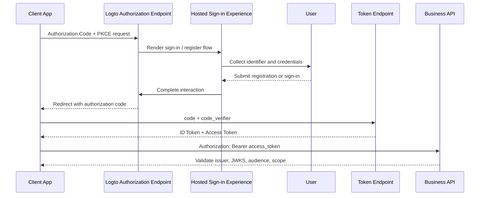
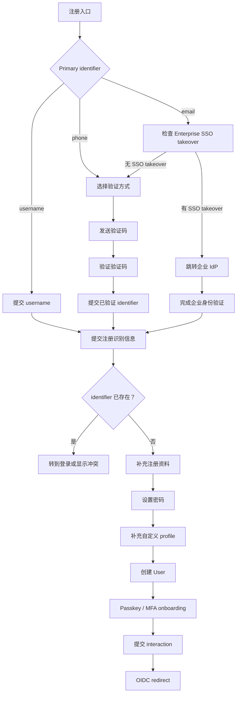
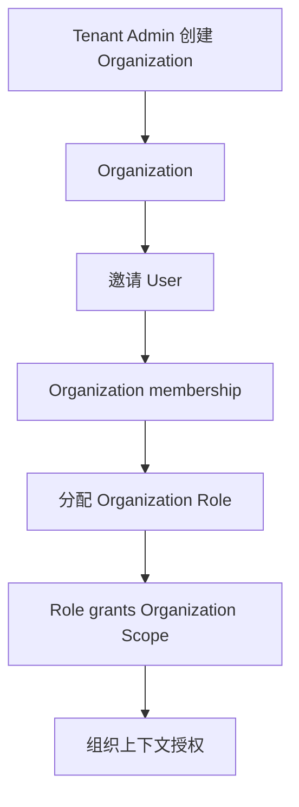

# Logto 使用流程：从注册到业务 API

> 本文把“注册”拆成两层：
>
> 1. **Logto Tenant / Console 初始化**：管理员创建 Tenant、Application 和登录体验配置；
> 2. **业务终端用户注册**：用户通过 OIDC/OAuth 业务应用进入 Hosted Sign-in Experience，完成注册、登录和授权。
>
> 两者不能混为一个 User。Tenant 管理员是控制面身份；终端 User 是 Tenant 内由 Logto 签发 OIDC 身份的主体。

文档导航：[文档总索引](README.md)。

本文只负责产品和用户时序；表字段见 [`logto-source-domain-model.md`](logto-source-domain-model.md)，接口、校验和状态变化见 [`logto-api-flow.md`](logto-api-flow.md)。

## 1. 总体流程



## 2. 第一层：Tenant 和应用初始化

### 2.1 创建 Tenant

Tenant 是 Logto 的项目和数据隔离边界。创建 Tenant 后，Tenant 下的用户、应用、资源、角色、组织、连接器和登录体验配置都归属于该 Tenant。

源码中的 `tenants` 模型包含：

- `id`
- `name`
- `tag`
- `created_at`
- `is_suspended`
- 可选的 `db_user` / `db_user_password`

源码：[`packages/schemas/src/models/tenants.ts`](https://github.com/logto-io/logto/blob/master/packages/schemas/src/models/tenants.ts)

### 2.2 注册 Application

Application 表示业务客户端。源码支持以下类型：

```text
Native
SPA
Traditional
MachineToMachine
Protected
SAML
```

Application 主要配置：

- `name`
- `type`
- OIDC client metadata
- custom client metadata
- redirect URI
- post logout redirect URI
- grant types
- token endpoint authentication method
- third-party / first-party 属性
- 应用自定义数据

数据库核心表：

- [`packages/schemas/tables/applications.sql`](https://github.com/logto-io/logto/blob/master/packages/schemas/tables/applications.sql)
- [`packages/schemas/tables/application_secrets.sql`](https://github.com/logto-io/logto/blob/master/packages/schemas/tables/application_secrets.sql)

Application secret 已从旧的 `applications.secret` 逐步独立到 `application_secrets`。confidential client、Traditional、M2M 等场景需要单独管理 secret 生命周期。

### 2.3 配置 Sign-in Experience

Sign-in Experience 是 Tenant 级登录注册策略，决定 Hosted Sign-in Experience 如何运行。

主要配置：

```text
登录注册模式：SignIn / Register / SignInAndRegister
identifier：username / email / phone
密码策略
社交登录
企业 SSO
验证码
MFA
Passkey
CAPTCHA
Trusted Device
条款和隐私政策
品牌、颜色、Logo、CSS
自定义注册字段
用户名策略
密码找回方式
```

源码：[`packages/schemas/tables/sign_in_experiences.sql`](https://github.com/logto-io/logto/blob/master/packages/schemas/tables/sign_in_experiences.sql)

### 2.4 配置 Resource、Scope 和 Role

业务 API 先注册 Resource：

```text
Resource indicator = https://api.example.com
```

再在 Resource 下创建 Scope：

```text
invoice:read
invoice:write
```

Role 通过关系表聚合 Scope：

```text
Role
  → roles_scopes
  → Scope
  → Resource
```

用户和 M2M Application 通过不同关系表获得 Role：

```text
User
  → users_roles
  → User Role

M2M Application
  → applications_roles
  → M2M Role
```

源码：

- [`packages/schemas/tables/resources.sql`](https://github.com/logto-io/logto/blob/master/packages/schemas/tables/resources.sql)
- [`packages/schemas/tables/scopes.sql`](https://github.com/logto-io/logto/blob/master/packages/schemas/tables/scopes.sql)
- [`packages/schemas/tables/roles.sql`](https://github.com/logto-io/logto/blob/master/packages/schemas/tables/roles.sql)
- [`packages/schemas/tables/roles_scopes.sql`](https://github.com/logto-io/logto/blob/master/packages/schemas/tables/roles_scopes.sql)

## 3. 第二层：业务应用发起登录

业务应用不直接调用“注册用户”数据库接口，而是发起标准 OIDC 授权请求：

```text
业务应用
  → /oidc/auth
       client_id
       redirect_uri
       response_type=code
       scope=openid ...
       state
       nonce
       code_challenge
       code_challenge_method=S256
```

Logto 根据 `client_id` 找到 Application，再根据 Application 所属 Tenant 和登录体验配置进入 Hosted Sign-in Experience。

典型流程：



## 4. 终端用户注册流程

Logto 源码把注册入口分为四类：

```text
Identifier sign-up
Enterprise SSO
Social sign-in
One-time token / magic link
```

源码流程图：

- [`end-user-flows/register-flow.md`](https://github.com/logto-io/logto/blob/master/end-user-flows/register-flow.md)

### 4.1 Identifier 注册



Identifier 注册的核心步骤：

1. 选择 username、email 或 phone 作为主要 identifier；
2. 如启用 email / phone verification，发送并验证验证码；
3. 检查 identifier 是否已被使用；
4. 如果 identifier 已存在，离开注册流程，建议用户转登录或完成账号绑定；
5. 收集缺失的必填 identifier；
6. 按 Sign-in Experience 要求设置 password；
7. 收集 custom profile fields；
8. 创建 Tenant-local User；
9. 根据策略绑定 Passkey；
10. 根据策略绑定或验证 MFA；
11. 提交 interaction，回到 OIDC 授权流程。

### 4.2 Social 注册

Social callback 验证成功后，Logto 会依次判断：

```text
是否已有相同 social identity
  ├─ 是：直接登录
  └─ 否：是否存在相关 User
          ├─ 是且允许自动绑定：绑定后登录
          ├─ 是但不允许自动绑定：显示账号绑定选择
          └─ 否：创建新 User
```

“相关 User”可能通过已验证的 email 或 phone 发现。自动账号绑定是否允许是安全敏感策略，不能仅根据邮箱字符串直接合并账号。

### 4.3 Enterprise SSO 注册

```text
企业 IdP 登录
  → 验证 SSO callback
  → 查找已有 enterprise identity
  → 查找已验证 email 关联的 User
  → 自动绑定或进入账号绑定
  → 如果没有关联 User，则创建新 User
```

Enterprise SSO 注册通常跳过普通 CAPTCHA 和部分 profile fulfillment，因为身份验证由外部 IdP 完成。

### 4.4 One-time token / magic link 注册

```text
验证一次性 token
  → User 已存在：进入登录路径
  → User 不存在：使用 token 中的可信身份创建 User
```

一次性 token 必须有短 TTL、单次消费和明确的 tenant / connector 绑定。

## 5. User 创建后的认证收尾

用户创建不是 OIDC 流程的终点。Logto 还会根据策略执行：

### Passkey

- 判断 Passkey 是否启用；
- 如果已经绑定，跳过创建；
- 如果未绑定，可以提示创建；
- WebAuthn 成功后将 credential 绑定到 User。

### MFA

根据 Sign-in Experience 和 Organization 策略判断：

```text
是否强制 MFA
  ├─ 否：可选择 onboarding 或跳过
  └─ 是：必须绑定缺失 factor
```

支持的 MFA factor 由具体配置决定，包括：

- authenticator app
- Passkey
- email
- phone
- backup codes

### Interaction 提交

完成注册、身份验证、Passkey 和 MFA 后，提交 interaction。Logto 随后结束授权流程并向 Application 的 redirect URI 返回 authorization code。

## 6. Authorization Code 换 Token

Client 收到 authorization code 后，必须向 Token Endpoint 提交：

```text
code
client_id
redirect_uri
code_verifier
```

Logto 必须验证 authorization code 是否：

- 属于正确 Tenant；
- 属于正确 Application；
- 绑定相同 redirect URI；
- 绑定相同 PKCE challenge；
- 尚未过期；
- 尚未被消费。

源码中的 OIDC 临时状态统一存储在：

- [`packages/schemas/tables/oidc_model_instances.sql`](https://github.com/logto-io/logto/blob/master/packages/schemas/tables/oidc_model_instances.sql)

该表包含：

```text
tenant_id
model_name
id
payload
expires_at
consumed_at
```

## 7. Token 和业务 API 使用

Token 使用关系：

```text
ID Token
  → Client 识别已认证 User

Access Token
  → Business API 验证 issuer / signature / audience / scope

Refresh Token
  → 按 Logto 配置获取新的 Access Token
```

Resource 的 `indicator` 同时作为 access token 的 audience 来源；Scope 归属于 Resource。

业务 API 不应该读取 Logto 数据库，而应通过：

- issuer
- JWKS
- audience
- scope
- UserInfo / Management API（确有需要时）

完成验证。

## 8. Session、Grant 和后续访问

Logto 使用 `oidc_model_instances` 保存 OIDC provider 的 Session、Grant 和其他带 TTL 的临时模型。源码通过 payload 中的 `accountId`、`uid`、`grantId`、`userCode` 等字段建立查询索引。

概念上可理解为：

```text
User
  → Session
  → Client Grant / Consent
  → Authorization Code
  → Access Token
```

这些对象的生命周期不同：

- Session：用户登录会话；
- Grant：User 与 Application 的授权关系；
- Authorization Code：一次性短期授权凭据；
- Access Token：API 访问凭据；
- Refresh Token：按 provider 配置轮换和撤销。

## 9. Organization 使用流程

Organization 是 Tenant 内的业务组织，不是 Tenant，也不是 User。



源码关系：

```text
Organization
  → organization_user_relations
  → User

Organization Role
  → organization_role_user_relations
  → User + Organization

Organization Role
  → organization_role_scope_relations
  → Organization Scope
```

数据库强制组织角色分配前必须存在成员关系：

```text
Organization Role assignment
  requires existing Organization membership
```

Organization 的邀请、JIT provisioning、organization SSO 和 organization token 是后续能力，不应和最小 OIDC 注册闭环混在一起。

## 10. Logout / revoke / account lifecycle

典型生命周期：

```text
User 注册
  → 登录
  → 创建 Session / Grant
  → 获取 Token
  → 访问 API
  → logout / revoke / suspend
  → Session 或 Grant 失效
```

User 被 suspend、密码变更、MFA 变更、Refresh Token replay 或管理员撤销时，应根据具体 token 类型处理：

- 新登录被拒绝；
- Session 按策略撤销；
- Refresh Token family 撤销；
- 已签发 JWT 是否等到 `exp`，由系统的 token TTL 和撤销策略决定。

## 11. 对 Roseto 的实现顺序建议

第一条可执行切片建议严格按以下顺序：

1. 创建 Tenant；
2. 注册 public Web / SPA Application；
3. 配置精确 redirect URI；
4. 配置最小 Sign-in Experience；
5. 创建一个 Resource 和两个 Scope；
6. 发起 Authorization Code + PKCE；
7. 完成 email 或 username + password 注册；
8. 创建 Tenant-local User；
9. 返回 authorization code；
10. 换取 ID Token 和 Access Token；
11. 通过 JWKS 验证 access token；
12. 访问 sample API，验证 scope 403；
13. 暂不实现 Refresh Token、Organization Token、Social Connector 和完整 Console。

## 12. 官方源码与文档来源

### 源码流程

- [Register flow](https://github.com/logto-io/logto/blob/master/end-user-flows/register-flow.md)
- [Sign-in flow](https://github.com/logto-io/logto/blob/master/end-user-flows/sign-in-flow.md)
- [Schema tables](https://github.com/logto-io/logto/tree/master/packages/schemas/tables)

### 官方文档

- [Application data structure](https://docs.logto.io/integrate-logto/application-data-structure)
- [Organizations](https://docs.logto.io/organizations)
- [Authorization](https://docs.logto.io/authorization)
- [Sign-in Experience](https://docs.logto.io/concepts/sign-in-experience)
- [Sessions](https://docs.logto.io/sessions)
