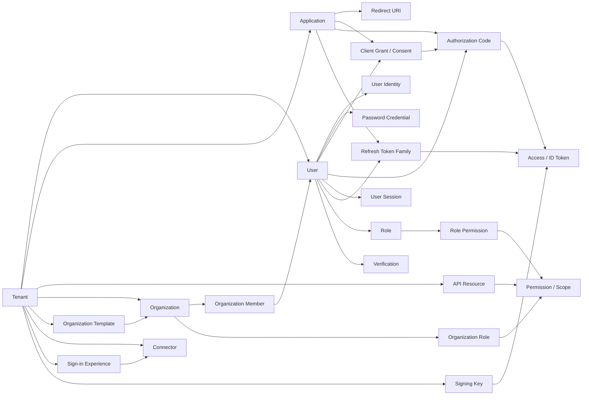

# Roseto：Java 版 Logto 产品方案

> 文档状态：方案基线  
> 目标读者：产品、领域建模、后端与基础设施实现者  
> 使用方式：先按第 9 节实现第一条垂直切片，再按第 7 节扩展能力；第 13 节仅用于借鉴 Logto 的领域拆分，不代表 Roseto 必须复制 Logto 的物理表结构。

## 0. 一页摘要

### 产品目标

Roseto 是独立的 Java IAM / CIAM 产品。第一阶段只证明一条可运行链路：

```text
Tenant
  → Application
  → User / Password Identity
  → Authorization Code + PKCE
  → OIDC Discovery / JWKS
  → ID Token / Access Token
  → Rose Resource Server
```

### 不变约束

| 约束 | 结论 |
|---|---|
| 部署形态 | 模块化单体；暂不拆微服务 |
| 依赖方向 | Roseto 独立构建；不依赖 Rose，Rose 只通过 OIDC/JWT 合同接入 |
| 分层 | domain/application 不依赖 Spring；infrastructure 承担技术适配 |
| 多租户 | 每个查询、缓存、事件与授权判断都显式处理 `tenantId` |
| 协议范围 | 第一版只做 Authorization Code + PKCE |
| 第一版明确不做 | 社交连接器、完整 Console、SAML、SCIM、MCP、计费、多区域 |
### Cloud 产品边界

Roseto 不把 Logto Cloud 当作可通过 `IS_CLOUD` 开关直接获得的能力。Logto OSS 中可以参考 Cloud Console 的前端页面、API 类型、seed 数据和 Core 条件分支，但完整的 Cloud Control Plane 后端不作为 OSS 模块提供。

Roseto 必须自主实现 Cloud 控制面：

```text
Platform Account
  ├─ Tenant Provisioning
  ├─ Tenant Membership / Invitation
  ├─ Tenant Switching
  ├─ Region
  ├─ Subscription / Billing
  ├─ Quota / Usage Metering
  └─ Cloud Management API
```

Cloud 控制面与 Tenant Core 的边界：

```text
Roseto Cloud Control Plane
  → Account / Tenant / Subscription / Usage
  → Roseto Tenant Core
      → User / Application / OIDC / Organization
```

Cloud Console 是 Cloud API 的客户端；数据库 seed 只初始化数据，不会生成 Cloud Control Plane HTTP 服务。Roseto 不直接复制 Logto Cloud 的源代码、品牌资源、文案或专有实现。

### 验收出口

标准 OIDC Client 可以仅通过 `issuer-uri` 接入 Roseto；Spring Boot 业务 API 能验证 Roseto 签发的 access token，并对 scope 不足返回 403、过期 token 返回 401。

### 文档导航

- 文档总索引：[`README.md`](README.md)
- 架构和依赖边界：第 1、3、4、6 节
- 领域模型和能力范围：第 2、5、7 节
- 第一条可执行切片：第 9 节
- 安全基线：第 8 节
- Logto 表、字段与关系：[`logto-source-domain-model.md`](logto-source-domain-model.md)
- Logto 产品和用户时序：[`logto-user-flow.md`](logto-user-flow.md)
- Logto API、校验与状态流：[`logto-api-flow.md`](logto-api-flow.md)
---

## 1. 决策


Roseto 是独立的 Java IAM / CIAM 产品，单独建立 Git 仓库；Rose 继续保持企业应用横切能力 SDK 的定位。

- 产品仓库：`roseto`
- 产品包名建议：`io.zhijun.roseto`
- 运行时：Java 21、Spring Boot 4.1
- 初始形态：模块化单体，不拆微服务
- 数据库：PostgreSQL
- 共享状态：Redis
- 协议：OIDC、OAuth 2.1、JWT、JWKS；后续增加 SAML
- UI：管理 Console 与 Hosted Sign-in Experience 分开演进
- 依赖关系：Roseto 独立构建和发布，不依赖 Rose；Rose 通过标准 OIDC / JWT 合同接入。

### 1.1 决策状态

#### 已决策

- Roseto 独立于 Rose 发布、构建和测试；不引入 Rose Maven 依赖。
- 第一形态是模块化单体，不提前拆成多个部署服务。
- 每个 Tenant 使用独立 issuer，采用路径型 URL，例如 `https://auth.example.com/t/{publicTenantKey}`。
- `publicTenantKey` 是不可变的公开租户标识，不直接暴露数据库 UUID，也不能使用可修改 slug。
- 每个 Tenant 使用独立 Signing Key。
- Access Token 使用 JWT；Phase 0 默认 TTL 为 5 分钟。
- Phase 0 只支持 public client + Authorization Code + PKCE，并只允许 `S256`。
- Phase 0 暂不交付 Refresh Token；Phase 1 再实现 rotation、family、replay 和撤销。
- Phase 0 只实现一个固定 API Resource 和两种 scope，用于验证 audience、scope 和 Rose 403。
- Phase 0 首方 Web Application 自动跳过 consent，但保留 `ConsentStore` seam。
- Phase 0 使用最小协议 claims；UserInfo 和用户 claims 只返回 `sub`。
- 用户禁用或 logout 后，Session、Refresh Token 和新登录立即失效；已有 JWT 最多存活到 `exp`。
- OrganizationTemplate 落库；创建组织时复制角色和权限，组织之后独立演进。
- 第一个 Tenant 和管理主体通过一次性 bootstrap 配置创建，初始化完成后关闭 bootstrap 通道。
- 生产环境使用 KMS/Vault 管理私钥；开发和测试使用可替换的加密文件或内存 adapter。
- Phase 0 使用固定 Argon2id 参数和全局基础密码策略；tenant 自定义密码策略延后。
- 旧 verification-only key 至少保留到最大 token TTL 加时钟偏差之后。
- Roseto domain/application 不依赖 Spring Boot starter。

#### 仍待决策

以下事项需要在实现相应能力前冻结：

- Global Role 与 Organization Role 是否允许引用同一个 Permission。
- Phase 1 Refresh Token 的具体 token record / lineage 数据模型。
- OrganizationTemplate 版本升级、复制和审计 API。

#### 设计假设

- 第一版单区域部署，PostgreSQL 和 Redis 均以可恢复、可观测方式运行。
- Roseto 协议核心和完整后端可以脱离 Rose 编译、测试、启动和发布；Rose 仅作为外部 Resource Server 进行兼容验证。
- 所有协议错误、领域错误和基础设施错误都有稳定的错误码，不把内部异常直接暴露给客户端。

Rose 不是 Roseto 的运行时依赖。Roseto 独立承载用户目录、组织目录、OIDC Provider、管理后台和通知业务；Rose 只作为外部 OIDC/JWT 客户端或 Resource Server 进行兼容验证。

## 2. 产品定位

Roseto 不是 JWT 工具或登录 Starter，而是面向 SaaS、企业应用和 AI 应用的身份与访问管理平台：

```text
Tenant
  ├─ User / Identity
  ├─ Application
  ├─ API Resource / Scope
  ├─ Role / Permission
  ├─ Organization
  ├─ Connector
  ├─ Sign-in Experience
  ├─ Session / Verification
  ├─ OIDC / OAuth Provider
  ├─ Management API
  └─ Console
```

第一阶段目标不是完全复制 Logto，而是交付一个可被真实业务应用接入的 Java OIDC Provider：

```text
Roseto
  → Authorization Code + PKCE
  → OIDC token / UserInfo
  → Rose Resource Server Starter
  → 受保护 Java 业务 API
```

## 3. 与 Rose 的依赖边界

### 3.1 可以复用的能力

Roseto 可以按需依赖以下 Rose 模块：

| Roseto 需求 | Rose 依赖 | 使用方式 |
|---|---|---|
| HTTP envelope、参数校验、错误兜底 | `rose-web-spring-boot-starter` | Roseto Web 适配层复用 |
| 安全上下文、JWT/JWKS Resource Server、MFA 契约 | `rose-security-spring-boot-starter` | Roseto 管理 API 与业务 API 保护 |
| Risk Decision、认证风控适配 | `rose-risk-spring-boot-starter` | Roseto 登录、注册、找回密码等风险动作 |
| 审计事件 | `rose-audit` | 管理操作和安全事件记录 |
| 租户上下文、数据范围、字段加密 | `rose-mybatis-spring-boot-starter` | 仅 infrastructure 层依赖 |
| 开发态 PostgreSQL / Redis | `rose-devservice-spring-boot-starter` | 仅开发和测试环境 |
| 稳定基础类型 | `rose-core` | Domain / application 可谨慎复用 |

### 3.2 不应复用的职责

以下职责归 Roseto 产品域，不下沉到 Rose：

- User、UserIdentity、Application 持久化模型
- Tenant 与 Organization 业务规则
- Password credential 生命周期
- OIDC Provider 授权码和 consent 事务
- Token issuer 的产品级签发流程
- Connector 管理和外部身份绑定
- Sign-in Experience 配置
- Management API
- Account API
- Console
- Cloud / self-hosted 部署业务

### 3.3 依赖原则

- Rose 永远不能依赖 Roseto。
- Roseto domain 不直接依赖任何 Spring Boot starter。
- Roseto application 通过 port 使用用户目录、凭据、会话、连接器和密钥存储。
- Roseto infrastructure 只依赖 PostgreSQL、Redis、Spring Authorization Server、MyBatis Plus 和 Flyway，不依赖 Rose starter。
- Rose 的 JWT Resource Server 能验证 Roseto 签发的 access token，但 Roseto 不应直接复用 Rose 的本地登录 token factory 作为完整 OIDC Provider。

### 3.4 通知能力

通知属于 Roseto 自身能力，不单独拆 Maven 模块，也不依赖 `rose-notify`：

```text
roseto-domain
  └─ NotificationSender

roseto-infrastructure
  └─ SMTP / Email / SMS / Webhook adapters

roseto-app
  └─ verification、password reset、MFA、invitation、security alert use cases
```

Roseto 负责通知业务语义：

- 邮箱验证
- 密码重置
- MFA 辅助通知
- 组织邀请
- 安全告警

`roseto-infrastructure` 负责通用出站机制：

- Provider SPI
- 模板渲染
- 异步发送
- 重试与幂等
- 投递状态
- 脱敏日志

## 4. Roseto 仓库结构

推荐使用单仓库、三模块模块化单体：

```text
roseto/
├── pom.xml
├── roseto-domain/
│   ├── domain/
│   ├── application/
│   └── spi/
├── roseto-infrastructure/
│   ├── mybatis/
│   ├── flyway/
│   ├── postgres/
│   ├── redis/
│   ├── oidc/
│   └── security/
├── roseto-app/
│   ├── management-api/
│   ├── account-api/
│   ├── cloud-api/
│   ├── experience-api/
│   ├── authorization-endpoints/
│   ├── static/
│   └── bootstrap/
├── frontend/
│   ├── console/
│   └── experience/
└── docs/
```

Maven 模块固定为三个：

```text
roseto-domain
roseto-infrastructure
roseto-app
```

`frontend/` 是前端构建目录，不是 Maven module；sample API 使用 `roseto-app` 的 test fixture，不单独建立 Maven module。

依赖方向：

```text
roseto-app → roseto-infrastructure → roseto-domain
roseto-app → roseto-domain
```

`roseto-domain` 不依赖 Spring、MyBatis Plus、PostgreSQL、Redis、Rose 或 Web 层。`roseto-infrastructure` 负责所有技术适配；`roseto-app` 负责 Spring Boot、HTTP、静态资源、协议 endpoint 和单端口启动。

## 5. 核心领域模型

### 5.1 Tenant

Roseto 实例中的隔离边界。Tenant 拥有用户、应用、API Resource、角色、连接器、登录体验、组织和密钥配置。

`Tenant` 与 `Organization` 不能混用：

- Tenant：IAM 项目或实例级隔离边界。
- Organization：业务侧的公司、团队、工作区或客户租户。

### 5.2 User 与 UserIdentity

`User` 表示 Roseto 内的稳定用户主体；`UserIdentity` 表示登录身份。

```text
User
  ├─ password identity
  ├─ email identity
  ├─ phone identity
  ├─ social identity
  ├─ OIDC identity
  └─ SAML identity
```

邮箱或手机号不能直接作为用户主键。账号绑定、解绑、合并和冲突必须是明确的应用服务操作。

### 5.3 Application

表示接入 Roseto 的客户端：

- Web application
- SPA
- Native application
- Traditional web application
- Machine-to-machine application
- CLI

主要配置：

- client ID / client secret
- application type
- redirect URI
- post logout redirect URI
- grant types
- token endpoint auth method
- first-party / third-party
- allowed organization usage

### 5.4 ApiResource、Permission、Role

```text
ApiResource
  └─ Permission / Scope

Global Role
  └─ Global Permission
       └─ User / M2M Application

Organization Role
  └─ Organization Permission
       └─ Organization member / Organization M2M Application
```

推荐使用资源标识：

```text
resource: https://api.example.com
scopes:
  - invoice:read
  - invoice:write
```

Global Role 与 Organization Role 必须是不同作用域的授权对象。角色是权限集合，不是业务授权判断本身；业务 API 最终检查 permission / scope，并结合 tenant、organization 和资源归属。是否允许同一个 Permission 同时被全局角色和组织角色引用，必须作为待决策项固定。

### 5.5 Organization 与 OrganizationTemplate

`Organization` 是业务租户、团队或工作区；`OrganizationTemplate` 定义所有组织可复用的角色和权限结构。

```text
OrganizationTemplate
  ├─ organization roles
  └─ organization permissions

Organization
  ├─ members
  ├─ member roles
  ├─ organization SSO
  └─ organization-scoped API permissions
```

同一个用户可以属于多个组织，并在不同组织中拥有不同角色。

### 5.6 Session、Verification、Connector

- `UserSession`：浏览器或 SSO 登录会话、设备和撤销状态。
- `ClientGrant`：User 与 Application 的授权关系和 consent。
- `RefreshTokenFamily`：refresh token rotation、replay detection 和 family revoke。
- `Verification`：邮箱、手机、MFA、Passkey 等验证事务。
- `Connector`：Social、Email、SMS、OIDC、SAML 等外部系统适配器。

Connector 只负责外部交互；认证事务、身份绑定和用户目录由 Roseto domain/application 拥有。

Connector 通过应用层的 Java SPI / boundary interface 接入；接口名称按职责命名，不强制添加统一后缀：

```text
ConnectorProvider
  ├─ authorization / callback
  ├─ exchangeCode / fetchProfile
  ├─ sendVerification
  └─ revoke / disconnect（按能力声明）
```

- `roseto-domain` 只定义 connector 配置、能力声明、外部身份绑定和错误合同；
- `roseto-infrastructure` 通过 Java adapter 实现 Google、GitHub、Microsoft、OIDC、Email、SMS 等 connector；
- `roseto-app` 负责 callback 路由、state / nonce / PKCE 校验、tenant 解析和审计；
- Connector adapter 必须声明支持的能力，未支持的操作返回稳定错误，不允许静默降级；
- Logto 只作为行为、字段和协议兼容参考，不复制其源代码、品牌资源或私有实现。

### 5.7 SignInExperience

租户级登录体验配置：

- 可用 identifier：email、phone、username
- 登录方式：password、verification code、social、SSO、passkey
- MFA 策略
- CAPTCHA 策略
- 品牌与主题
- 自定义文案
- 条款与隐私政策
- 注册策略

## 6. 技术架构

```text
┌──────────────────────────────────────┐
│ Console / Hosted Sign-in Experience  │
└──────────────────────────────────────┘
                  │
┌──────────────────────────────────────┐
│ Roseto modular monolith              │
│                                      │
│ Management API                       │
│ Experience API                       │
│ Account API                          │
│ OIDC / OAuth 2.1 endpoints           │
│ Session / Verification services      │
│ Connector adapters                   │
└──────────────────────────────────────┘
          │                 │
      PostgreSQL           Redis
```
### 6.1 Cloud 控制面架构

Cloud 能力采用同一模块化单体中的清晰模块边界，初期不拆成独立微服务：

```text
Platform Account / Cloud Console
              │
              ▼
Cloud Management API
  ├─ Tenant Provisioning
  ├─ Tenant Membership / Invitation
  ├─ Region
  ├─ Subscription / Billing
  └─ Quota / Usage
              │
              ▼
Tenant Core / Management API
  ├─ User / Identity
  ├─ Application
  ├─ Organization
  └─ OIDC / OAuth Provider
```

Cloud API 与 Tenant Management API 必须使用不同的认证和授权上下文：

- Cloud API 面向 Platform Account 和跨 Tenant 操作；
- Tenant Management API 面向单个 Tenant 的管理员；
- Cloud API 只能通过受控的 provisioning / membership service 修改 Tenant；
- 客户端传入的 `tenantId` 不能绕过 Platform Account membership 或 Tenant 管理权限；
- Subscription、Quota 和 Usage 是平台级状态，不落入普通 Tenant 业务权限判断。

Phase 0–2 只保留 Cloud API 的接口和边界，不交付计费、多区域或完整 Cloud Console；Cloud 控制面必须在单独的后续阶段实现。

### 推荐组件

- Java 21
- Spring Boot 4.1
- Spring MVC
- Spring Security
- Spring Authorization Server
- Nimbus JOSE JWT
- PostgreSQL
- Redis
- Flyway
- Testcontainers
- WebAuthn/FIDO2 Java library
- OpenAPI

Spring Authorization Server 只负责协议适配和授权服务器骨架；用户、租户、组织、权限、连接器和登录体验仍由 Roseto 自己的 domain/application 管理。

第一版固定使用路径型 issuer：

```text
https://auth.example.com/t/{publicTenantKey}
```

`publicTenantKey` 必须不可变且不等于数据库 UUID。TenantResolver 只接受可信 canonical host / issuer 解析结果；客户端传入的 `tenantId` 不能切换租户。

```text
请求
  → TenantResolver（根据 host / issuer / 管理上下文）
  → TenantContext（服务端建立，不信任客户端 tenantId）
  → domain/application
```

`TenantContext` 至少包含：

- `tenantId`
- `issuer`
- 当前调用主体 `subject`
- 可选的 `organizationId`

所有 repository、缓存 key、审计事件和授权判断都必须从该上下文获得租户范围。客户端传入的 `tenantId` 或 `organizationId` 只能作为候选筛选条件，不能作为授权事实。

### 6.2 Token Contract

在实现前为每种凭据固定以下合同：

| 凭据 | 用途 | 最小约束 |
|---|---|---|
| Authorization Code | 一次性授权事务 | 短 TTL、单次消费，并绑定 tenant、client、redirect URI、user、PKCE challenge |
| ID Token | 向 OIDC Client 表示用户认证结果 | 必须包含正确的 `iss`、`sub`、`aud`、`iat`、`exp`、`nonce` |
| Access Token | 访问 API Resource | 必须明确 `iss`、`sub`、`aud`、`scope`、`iat`、`exp` 和 token 类型 |
| Refresh Token | 获取新 access token | 只有在 rotation、family、replay、撤销策略确定后才能交付 |

第一版合同：

- Access Token 是 JWT，默认 TTL 为 5 分钟。
- `aud` 对应唯一的固定 API Resource indicator。
- `scope` 使用 OAuth scope；Phase 0 固定两种 scope，permission 映射规则保持一对一。
- Phase 0 token 不携带 `organization_id`，组织 token 延后到 Phase 2。
- UserInfo 和用户 claims 只返回 `sub`。
- 用户禁用或 logout 后，Session 和未来可刷新凭据立即失效；已有 JWT 最多存活到 `exp`。

Rose Resource Server 只依赖稳定的 issuer、JWKS、audience 和 scope 合同，不依赖 Roseto 私有 API。

### 6.3 协议适配 seam

Spring Authorization Server 只位于 infrastructure / protocol adapter 层，不能渗透到 domain/application：

```text
Roseto Application / Domain
  ├─ Application services
  ├─ UserAuthentication
  ├─ AuthorizationTransactionStore
  ├─ ConsentStore
  ├─ TokenIssuer
  └─ SigningKeyProvider
           ↓ adapters
Spring Authorization Server
```

适配关系至少包括：

- `RegisteredClientRepository` → Roseto Application 查询；
- `OAuth2AuthorizationService` → Roseto Authorization Code、Grant 和 Token 状态；
- `OAuth2AuthorizationConsentService` → Roseto Consent；
- user authentication → Roseto User / Credential；
- token customizer → Roseto audience、scope、organization claims；
- UserInfo → Roseto User 和 claims policy。

Spring 类型只允许出现在 adapter 和 bootstrap 层。domain/application 的测试必须可以使用内存 adapter，不依赖 Spring Context。

### 6.4 授权事务与凭据状态

不要用一个 `Session` 对象承载所有协议状态：

```text
UserSession
  └─ 浏览器 / SSO 登录会话

ClientGrant
  └─ User + Application 的授权关系和 consent

AuthorizationCode
  └─ 短期、一次性、绑定 PKCE 的授权事务

RefreshTokenFamily
  └─ rotation、replay detection 和 family revoke

AccessToken
  └─ 短期 API 访问凭据
```

密码也不直接等同于普通 `UserIdentity`：

```text
User
├─ UserIdentity（email / phone / external provider）
├─ PasswordCredential
└─ Verification
```

密码凭据应独立处理哈希参数、升级、变更和会话撤销；外部身份应独立处理 provider、subject、绑定和解绑。

### 6.5 事务、事件与一致性

跨实体操作按以下规则处理：

```text
数据库事务
  → 写业务状态
  → 写 outbox event
  → 提交
  → 异步投递通知、审计或 webhook
```

必须在同一数据库事务内完成的例子：

- 密码变更与 refresh token family / session 撤销；
- authorization code 的消费与状态更新；
- 用户禁用与新登录禁止；
- signing key active / verification-only 状态切换。

通知、审计和 webhook 不应直接阻断核心业务事务；投递失败通过 outbox 重试和幂等键处理。Redis 写入失败不能丢失 PostgreSQL 中的权威状态。

### 6.6 第一版模块与运行基线

第一版只使用三个 Maven 模块，不创建没有实现的空模块：

```text
roseto-domain
roseto-infrastructure
roseto-app
```

约束：

- `roseto-domain` 承载 Tenant、User、Application、Authorization、Session、Cloud ports 和 use cases，不依赖 Spring、MyBatis Plus、PostgreSQL、Redis 或 Rose；
- `roseto-infrastructure` 承载 MyBatis Plus、Flyway、PostgreSQL、Redis、key store、OIDC adapter 和安全实现；
- `roseto-app` 承载 Spring wiring、HTTP API、Console / Experience 静态资源、协议 endpoint 和单端口启动；
- Cloud、Console、Experience、OIDC、Management API 都是 `roseto-app` 内的 package boundary，不单独创建 Maven module；
- sample API 是 `roseto-app` 的测试 fixture，不单独创建 Maven module；
- ArchUnit 检查 package boundary 和依赖方向。

从 Phase 0 起就必须具备：

- Flyway migration；
- PostgreSQL 和 Redis 的健康检查；
- readiness / liveness；
- 结构化日志和 correlation ID；
- issuer、token TTL、JWKS cache、密钥来源的显式配置；
- Testcontainers 集成测试；
- 不依赖 Rose starter 的协议核心测试。

## 7. 实现阶段

### Phase 0：协议骨架

Phase 0 拆为三个可独立验收的切片，避免同时调试协议、授权、生命周期和跨项目集成。

#### Slice A：OIDC 协议最小闭环

交付：

- Tenant bootstrap
- 一个 Web Application
- 一个密码用户和最小登录页
- OIDC Discovery
- JWKS endpoint
- `/authorize`
- `/token`
- Authorization Code + PKCE（只允许 `code` 和 `S256`）
- ID token / access token
- Authorization Code 短 TTL、单次消费和 replay 拒绝

验收：

```text
创建 tenant
→ 注册 application
→ 配置精确 redirect URI
→ 创建密码用户
→ Authorization Code + PKCE 登录
→ 换取 ID token / access token
→ 错误 verifier、错误 redirect URI、授权码重放均被拒绝
```

#### Slice B：资源授权与 Rose 集成

交付：

- API Resource
- Permission / Scope
- access token 的 audience 和 scope 合同
- Rose Resource Server `issuer-uri` 验证
- scope 不足的 403
- token 过期或 issuer 不匹配的 401

验收：

```text
申请 resource scope
→ token 包含正确 audience / scope
→ Rose 验证签名和 issuer
→ scope 足够返回 2xx
→ scope 不足返回 403
→ token 过期返回 401
```

#### Slice C：密钥与会话生命周期

交付：

- Signing Key active / verification-only 状态
- JWKS 缓存策略
- key rotation
- UserSession
- logout / revoke
- 旧 key 在 token 有效期内继续验证

验收：

```text
轮换 signing key
→ 新 token 使用新 kid
→ 旧 token 在保留窗口内可验证
→ retire 前的 key 不影响有效旧 token
→ logout / revoke 后按既定策略失效
```

### Phase 1：可用 CIAM 核心

- 邮箱注册和验证
- 密码登录
- 密码找回
- refresh token rotation
- session management
- logout / revoke
- Account API
- Management API
- Hosted Sign-in page
- 基础 Console

### Phase 2：多租户授权

- Global RBAC
- API resources / scopes
- Machine-to-machine application
- Organizations
- Organization template
- Organization roles / permissions
- Organization token
- Organization membership
- Invitation
- JIT provisioning

### Phase 3：外部身份和强认证

- Google / GitHub / Microsoft social login
- OIDC connector
- SAML connector
- Email / SMS connector SPI
- MFA
- TOTP
- WebAuthn / Passkey
- CAPTCHA
- Identifier lockout
- Blocklist
- 登录风控

### Phase 4：企业能力

- Enterprise SSO
- domain verification
- organization-level SSO
- SCIM
- user provisioning
- audit logs
- webhooks
- actions
- impersonation
- custom token claims
- third-party token storage

### Phase 5：生态与部署

- Java SDK
- TypeScript SDK
- Spring Boot starter
- CLI
- Docker image
- Helm chart
- backup / restore
- tenant export / import
- metrics / tracing
- multi-region strategy
- MCP 管理接口

### Phase 6：Cloud 控制面

Phase 6 在 Tenant Core 可用后实现平台级 Cloud 能力。它不是把 `IS_CLOUD` 设为 true，也不是只执行 Cloud seed；必须交付可运行的 API、授权模型和最小 Console 流程。

#### Slice A：Platform Account 与 Tenant Provisioning

- Platform Account 注册、登录和会话；
- Platform Account 与 Tenant 的 membership；
- 创建、查询、更新和删除 Tenant；
- Tenant bootstrap 与初始化状态；
- Tenant 切换；
- Cloud Management API；
- 最小 Cloud Console Tenant 列表和创建页面。

#### Slice B：成员、邀请与权限

- Tenant member；
- invitation；
- Platform Role；
- Tenant Role；
- member scope / role 查询；
- 跨 Tenant 访问隔离；
- 审计 Platform Account 和 Tenant 管理操作。

#### Slice C：Region、Quota 与 Usage

- Region registry；
- Tenant region placement；
- quota 定义和 enforcement；
- usage event；
- usage aggregation；
- subscription 状态；
- Billing provider adapter（先保留 billing gateway，不在首个 Cloud slice 接入真实支付）。

Cloud API 最小合同：

```text
GET  /api/tenants
POST /api/tenants
GET  /api/tenants/{tenantId}
DELETE /api/tenants/{tenantId}
GET  /api/tenants/{tenantId}/members
GET  /api/tenants/{tenantId}/members/{userId}/scopes
GET  /api/tenants/{tenantId}/members/{userId}/roles
GET  /api/me/regions
GET  /api/me/usage
GET  /api/me/subscription
```

验收：

```text
Platform Account 登录
→ 创建 Tenant
→ 成为 Tenant member
→ 切换 Tenant
→ 使用 Tenant Management API
→ 无 membership 时跨 Tenant 请求被拒绝
```
## 8. 第一版安全基线

### OAuth / OIDC

- 只实现 Authorization Code + PKCE；Phase 0 只支持 public client 和 `S256`。
- 严格校验 state、nonce、redirect URI、issuer、audience 和 code verifier。
- 禁止 implicit grant。
- 禁止把 access token 放入 query string。
- 不接受请求参数控制的开放重定向。

### 密钥

- 每个 Tenant 使用独立 RSA 或 EC 非对称密钥。
- header 使用 `kid`。
- 通过 JWKS 发布公钥。
- 支持 active key 与 verification-only old keys。
- 生产私钥由 KMS/Vault 管理；开发和测试使用可替换的加密文件或内存 adapter。
- 旧 key 至少保留到最大 token TTL 加时钟偏差之后。

### Refresh Token

- 每次使用轮换。
- 检测 replay。
- 按 token family 撤销。
- 存储哈希而非明文。
- 支持设备级、会话级和全用户会话撤销。
- 密码变更后可以撤销所有会话。

### 密码与验证

- Argon2id 优先。
- 密码策略按 tenant 配置。
- 登录失败锁定。
- 密码重置 token 一次性、短 TTL。
- 邮箱和手机号验证状态独立维护。
- 不泄漏“用户不存在”和“密码错误”的差异。

### 多租户隔离

所有查询、缓存、事件和授权判断都必须明确处理：

```text
tenantId
organizationId
subject
```

不能把客户端传入的 `tenantId` 或 `organizationId` 直接当作授权事实。

### Web 与管理面

- 管理 API 明确 CSRF 策略；浏览器 cookie 使用 `HttpOnly`、`Secure`、`SameSite`。
- CORS 只允许显式配置的来源；Hosted Sign-in 设置 CSP、frame-ancestors 和 Referrer-Policy。
- 登录、注册、token、密码重置和 connector callback 都必须限流并记录 correlation ID。
- 日志不得包含 password、authorization code、refresh token、reset token 或私钥材料。

### 滥用与数据保护

- 按 IP、client、user 和 tenant 对登录及 token endpoint 做限流。
- 对 credential stuffing、密码喷洒、验证码滥用和 refresh token replay 产生审计事件。
- 明确 PII 分类、日志脱敏、审计保留周期、用户删除和 tenant 删除策略。
- 数据库备份、密钥材料和 tenant export 必须加密并有访问审计。

### 8.1 验收矩阵

| AC | 场景 | 预期 |
|---|---|---|
| AC-01 | redirect URI 不匹配 | 授权请求拒绝，不发生重定向 |
| AC-02 | PKCE verifier 错误 | token 请求拒绝 |
| AC-03 | authorization code 重放 | 第二次消费失败 |
| AC-04 | state / nonce 不匹配 | 授权结果拒绝 |
| AC-05 | audience 或 issuer 不匹配 | Resource Server 返回 401 |
| AC-06 | scope 不足 | Resource Server 返回 403 |
| AC-07 | 跨 tenant 读取资源 | 拒绝，不能通过客户端 tenantId 绕过 |
| AC-08 | key rotation | 新 token 使用新 `kid`，旧 token 在保留窗口内可验证 |
| AC-09 | 用户禁用 | 新登录失败，既有会话按撤销策略处理 |
| AC-10 | refresh token replay | token family 撤销并产生审计事件 |

## 9. 第一条可执行垂直切片

第一条切片只做端到端最小产品，不先做社交连接器或完整 Console：

1. 创建 tenant。
2. 创建 Web application。
3. 配置精确 redirect URI。
4. 创建密码用户。
5. 通过 Authorization Code + PKCE 登录。
6. 签发 ID token 和 access token。
7. 通过 Discovery 和 JWKS 验证 token。
8. 使用标准 Spring Security Resource Server 保护 sample API。
9. 验证 scope 权限和 401/403 行为。
10. 轮换 signing key，确认旧 token 可验证、新 token 使用新 `kid`。

完成标准：标准 OIDC client 能接入 Roseto，Spring Boot 业务应用无需 Roseto 私有 API 即可通过 `issuer-uri` 验证 access token。

## 10. 明确不做的事情

第一版不做：

- 云计费
- 多区域部署
- 30+ connector
- 完整 SAML 双向能力
- SCIM
- Actions 沙箱
- MCP
- 低代码全功能 Console
- 多语言 SDK 全覆盖
- 微服务拆分

## 11. 许可证与实现方式

Rose 使用 Apache License 2.0；Logto 仓库使用 MPL-2.0。Roseto 可以通过协议和产品行为对 Logto 进行研究，也可以作为独立实现使用 Rose 依赖。

不要直接复制 Logto 的源代码、产品文案、品牌资源或专有实现细节。若未来复制或修改 Logto 源代码，必须单独进行 MPL-2.0 合规审查，包括源文件声明、许可证、修改说明和分发方式。

## 12. 参考资料

- [Logto GitHub](https://github.com/logto-io/logto)
- [Roseto 文档导航](README.md)
- [Logto 源码领域模型整理](logto-source-domain-model.md)
- [Logto 从注册到业务 API 的使用流程](logto-user-flow.md)
- [Logto API 接口流程与实现线索](logto-api-flow.md)
- [Logto Introduction](https://docs.logto.io/introduction)
- [Logto Authorization](https://docs.logto.io/authorization)
- [Logto User Management](https://docs.logto.io/user-management)
- [Logto Organizations](https://docs.logto.io/organizations)
- [Logto Connectors](https://docs.logto.io/connectors)
- [Logto Sign-in Experience](https://docs.logto.io/concepts/sign-in-experience)
- [Logto Sessions](https://docs.logto.io/sessions)


## 13. Logto 参考领域模型

本节不是 Logto 源码的复制，也不是 Logto 数据库的逐表抄录，而是根据 Logto 官方文档和官方仓库整理出的**能力域关系**，用于校准 Roseto 的领域边界。实际实现前仍需以目标版本的 Logto schema、API contract 和协议规范为准。

### 13.1 领域边界

Logto 的核心可以归纳为六组：

| 能力域 | 核心实体 | 主要职责 |
|---|---|---|
| 租户与身份 | Tenant、User、User Identity | 隔离用户目录，承载一个用户的多个登录身份 |
| 客户端与协议 | Application、Redirect URI、Authorization Code、Session | 管理 OIDC/OAuth 客户端和授权事务 |
| 访问控制 | API Resource、Scope/Permission、Role | 将资源、权限和角色组合成可签发的授权结果 |
| 组织 | Organization、Member、Organization Role | 支持 B2B / SaaS 的组织成员和组织级权限 |
| 外部认证 | Connector、Sign-in Experience、Verification | 连接社会化登录、企业 SSO、验证和登录策略 |
| 密钥与令牌 | Signing Key、Access Token、Refresh Token | 签发、验证、轮换和撤销协议凭据 |

Logto 官方组织文档将 organization 作为多租户 SaaS / B2B 的通用概念；Roseto 在此基础上进一步明确 `Tenant` 是 IAM 实例级隔离边界，`Organization` 是业务侧团队、公司或工作区。两者不能混用。

### 13.2 领域模型关系图



关系解释：

- `User` 是稳定主体，`User Identity` 是登录方式；邮箱、手机号或外部 provider subject 不能直接代替用户主键。
- `Application` 是 OIDC/OAuth 客户端；`Redirect URI` 必须从属于 Application 并做精确匹配。
- `API Resource` 定义受保护资源，`Permission / Scope` 定义资源上的可授予能力，`Role` 只负责聚合权限。
- `Organization Member` 是 User 与 Organization 的关联；组织角色不能绕过组织成员关系直接授予用户。
- `Connector` 只负责外部系统交互；身份绑定、授权事务和用户目录仍归 Roseto。
- `Signing Key` 服务于令牌签发和 JWKS 验证；密钥轮换不能破坏旧令牌在有效期内的验证。
- `Password Credential`、`Client Grant`、`Authorization Code` 和 `Refresh Token Family` 分别表达凭据、consent、一次性授权事务和 refresh token 生命周期，不能合并为一个 Session。
- `Global Role` 与 `Organization Role` 必须有明确作用域；组织角色授予前必须存在 Organization Member。

### 13.3 概念 ER 图

下图是**面向 Roseto 实现的概念 ER 图**。它表达实体、主外键和基数，不承诺与 Logto 当前物理表一一对应；中间表是有意展开的多对多关系。

```mermaid
erDiagram
    TENANT ||--o{ USER : owns
    TENANT ||--o{ APPLICATION : registers
    TENANT ||--o{ API_RESOURCE : defines
    TENANT ||--o{ ROLE : defines
    TENANT ||--o{ ORGANIZATION : contains
    TENANT ||--o{ CONNECTOR : configures
    TENANT ||--|| SIGN_IN_EXPERIENCE : configures
    TENANT ||--o{ SIGNING_KEY : rotates

    USER ||--o{ USER_IDENTITY : has
    USER ||--o| PASSWORD_CREDENTIAL : owns
    USER ||--o{ SESSION : opens
    USER ||--o{ VERIFICATION : starts
    USER ||--o{ USER_ROLE : receives
    ROLE ||--o{ USER_ROLE : grants

    USER ||--o{ CLIENT_GRANT : authorizes
    APPLICATION ||--o{ CLIENT_GRANT : receives
    CLIENT_GRANT ||--o{ AUTHORIZATION_CODE : creates
    USER ||--o{ REFRESH_TOKEN_FAMILY : owns
    APPLICATION ||--o{ REFRESH_TOKEN_FAMILY : issues

    APPLICATION ||--o{ REDIRECT_URI : allows
    APPLICATION ||--o{ AUTHORIZATION_CODE : requests
    USER ||--o{ AUTHORIZATION_CODE : approves
    ROLE ||--o{ ROLE_PERMISSION : contains
    PERMISSION ||--o{ ROLE_PERMISSION : included_in

    ORGANIZATION ||--o{ ORGANIZATION_MEMBER : has
    USER ||--o{ ORGANIZATION_MEMBER : joins
    TENANT ||--o{ ORGANIZATION_TEMPLATE : defines
    ORGANIZATION_TEMPLATE ||--o{ ORGANIZATION : initializes
    ORGANIZATION_TEMPLATE ||--o{ ORGANIZATION_TEMPLATE_ROLE : contains
    ORGANIZATION_TEMPLATE_ROLE ||--o{ ORGANIZATION_TEMPLATE_ROLE_PERMISSION : contains
    PERMISSION ||--o{ ORGANIZATION_TEMPLATE_ROLE_PERMISSION : grants
    ORGANIZATION ||--o{ ORGANIZATION_ROLE : defines
    ORGANIZATION_ROLE ||--o{ ORGANIZATION_ROLE_PERMISSION : contains
    PERMISSION ||--o{ ORGANIZATION_ROLE_PERMISSION : grants
    ORGANIZATION_MEMBER ||--o{ ORGANIZATION_MEMBER_ROLE : receives
    ORGANIZATION_ROLE ||--o{ ORGANIZATION_MEMBER_ROLE : assigned
    TENANT {
        uuid id PK
        string public_tenant_key UK
        string name
    }
    USER {
        uuid id PK
        uuid tenant_id FK
        string status
    }
    PASSWORD_CREDENTIAL {
        uuid user_id PK
        string password_hash
        string hash_algorithm
        datetime changed_at
    }
    CLIENT_GRANT {
        uuid id PK
        uuid user_id FK
        uuid application_id FK
        string consent_status
    }
    REFRESH_TOKEN_FAMILY {
        uuid id PK
        uuid user_id FK
        uuid application_id FK
        string status
        datetime expires_at
    }
    USER_IDENTITY {
        uuid id PK
        uuid user_id FK
        string type
        string provider_subject
    }
    APPLICATION {
        uuid id PK
        uuid tenant_id FK
        string client_id UK
        string application_type
        string client_auth_method
        string status
    }
    REDIRECT_URI {
        uuid id PK
        uuid application_id FK
        string uri
    }
    AUTHORIZATION_CODE {
        uuid id PK
        uuid tenant_id FK
        uuid application_id FK
        uuid user_id FK
        uuid client_grant_id FK
        string code_hash UK
        string status
        datetime expires_at
    }
    API_RESOURCE {
        uuid id PK
        uuid tenant_id FK
        string indicator UK
    }
    PERMISSION {
        uuid id PK
        uuid resource_id FK
        string name
    }
    ROLE {
        uuid id PK
        uuid tenant_id FK
        string name
    }
    ROLE_PERMISSION {
        uuid role_id FK
        uuid permission_id FK
    }
    USER_ROLE {
        uuid user_id FK
        uuid role_id FK
    }
    ORGANIZATION_TEMPLATE {
        uuid id PK
        uuid tenant_id FK
        string name
        string version
    }
    ORGANIZATION {
        uuid id PK
        uuid tenant_id FK
        uuid template_id FK
        string name
    }
    ORGANIZATION_TEMPLATE_ROLE {
        uuid id PK
        uuid template_id FK
        string name
    }
    ORGANIZATION_TEMPLATE_ROLE_PERMISSION {
        uuid template_role_id FK
        uuid permission_id FK
    }
    ORGANIZATION_MEMBER {
        uuid organization_id FK
        uuid user_id FK
        string status
    }
    ORGANIZATION_ROLE {
        uuid id PK
        uuid organization_id FK
        string name
    }
    ORGANIZATION_ROLE_PERMISSION {
        uuid organization_role_id FK
        uuid permission_id FK
    }
    ORGANIZATION_MEMBER_ROLE {
        uuid organization_member_id FK
        uuid organization_role_id FK
    }
    SESSION {
        uuid id PK
        uuid tenant_id FK
        uuid user_id FK
        string status
        datetime expires_at
    }
    VERIFICATION {
        uuid id PK
        uuid tenant_id FK
        uuid user_id FK
        string type
        string status
    }
    CONNECTOR {
        uuid id PK
        uuid tenant_id FK
        string provider
    }
    SIGN_IN_EXPERIENCE {
        uuid tenant_id PK
        json config
    }
    SIGNING_KEY {
        uuid id PK
        uuid tenant_id FK
        string kid UK
        string status
    }
```



### 13.4 对 Roseto 的落地取舍

第一版不需要一次实现图中的全部实体。建议按以下依赖顺序落地：

1. `Tenant → Application → Redirect URI`
2. `Tenant → User → User Identity`
3. `Application + User → Authorization Code`
4. `Signing Key → OIDC Discovery / JWKS → Token`
5. `API Resource → Permission → Access Token`
6. `User → Session`
7. 再增加 Organization、Connector、Verification 和 Console

以下关系必须在数据库约束或应用服务中明确表达：

- 所有业务实体都必须能追溯到 `tenant_id`，跨租户外键引用必须被拒绝。
- `Application` 的 `client_id`、`Redirect URI` 和授权码校验属于协议边界，不能只依赖前端。
- 授权码、refresh token 和密码重置凭据只保存哈希或不可逆摘要。
- 组织角色授予前必须存在 `Organization Member`；全局角色和组织角色不能共用一套无作用域的授权判断。
- `User Identity` 的 `(tenant_id, type, provider_subject)` 需要唯一性约束，账号绑定和合并必须走显式应用服务。

### 13.5 参考来源与使用边界

- [Logto Organizations](https://docs.logto.io/organizations)：组织、多租户 SaaS、成员、组织角色和 JIT provisioning。
- [Logto Authorization](https://docs.logto.io/authorization)：API resources、scopes、roles 与权限模型。
- [Logto Connectors](https://docs.logto.io/connectors)：外部身份连接器。
- [Logto Sign-in Experience](https://docs.logto.io/concepts/sign-in-experience)：租户级登录体验配置。
- [Logto Sessions](https://docs.logto.io/sessions)：会话与令牌生命周期。
- [Logto GitHub](https://github.com/logto-io/logto)：实现和 schema 的版本化事实来源。

Logto 是参考对象，不是 Roseto 的实现规范。Roseto 应复用协议兼容性和领域启发，但不得直接复制 Logto 源代码、品牌文案、数据库实现或专有实现细节。
### 13.6 Cloud Console 与 Cloud API 参考清单

本节记录基于 Logto OSS Console 的 Cloud 页面路径、Cloud API 客户端和 `@logto/cloud/routes` 类型声明整理的接口清单。它是 Roseto 的行为参考，不是 Logto Cloud 私有实现的复制。

#### Console 路径

```text
/:tenantId/get-started
/:tenantId/dashboard
/:tenantId/applications
/:tenantId/api-resources
/:tenantId/users
/:tenantId/roles
/:tenantId/organizations
/:tenantId/connectors
/:tenantId/sign-in-experience
/:tenantId/mfa
/:tenantId/security
/:tenantId/audit-logs
/:tenantId/webhooks
/:tenantId/enterprise-sso

/onboarding
/accept/:invitationId
/profile
/delete-account
/subscriptions/:logtoEnterpriseId
/subscriptions/:logtoEnterpriseId/subscription
/subscriptions/:logtoEnterpriseId/billing-history
```

`/:tenantId/get-started` 中的 `tenantId` 是 URL 中的 Cloud Tenant public ID，例如 `x50cwp`。Cloud Console 的 API client 使用当前页面的 `window.location.origin` 作为 `baseUrl`，正式环境请求形如 `https://cloud.logto.io/api/...`；本地 Console 必须有同源 Cloud API 或显式反向代理，不能把 Vite 静态服务器当作 API。

#### Cloud API 认证

普通 Cloud API 使用 Platform Account 的 access token：

```http
Authorization: Bearer <token>
Accept-Language: zh-CN
```

Token resource indicator：

```text
https://cloud.logto.io/api
```

Tenant 成员和 Tenant 设置接口使用 Tenant Organization Token，不使用普通 Cloud API token。Roseto 必须分别建模 Platform Account 上下文和 Tenant Organization 上下文，不能仅依赖客户端传入的 `tenantId`。

#### Tenant 生命周期

```http
GET    /api/tenants
POST   /api/tenants
PATCH  /api/tenants/:tenantId
DELETE /api/tenants/:tenantId
POST   /api/tenants/subscriptions/plan
POST   /api/tenants/unsuspend
```

创建 Tenant 的最小请求体：

```json
{
  "name": "My project",
  "id": "optional-public-id",
  "regionName": "optional-region",
  "tag": "development"
}
```

#### 成员、邀请和 Tenant 设置

Platform Account 上下文：

```http
GET   /api/invitations
GET   /api/invitations/:invitationId
PATCH /api/invitations/:invitationId/status
```

Tenant Organization Token 上下文：

```http
GET    /api/tenants/:tenantId/members
GET    /api/tenants/:tenantId/members/:userId/scopes
GET    /api/tenants/:tenantId/invitations
POST   /api/tenants/:tenantId/invitations
POST   /api/tenants/:tenantId/invitations/:invitationId/message
PATCH  /api/tenants/:tenantId/invitations/:invitationId/status
PUT    /api/tenants/:tenantId/members/:userId/roles
DELETE /api/tenants/:tenantId/members/:userId
DELETE /api/tenants/:tenantId/invitations/:invitationId
GET    /api/tenants/:tenantId/settings
PATCH  /api/tenants/:tenantId/settings
```

成员角色至少包括：

```text
admin
collaborator
```

#### Subscription、Quota、Usage 和 Billing

```http
GET    /api/tenants/:tenantId/subscription
GET    /api/tenants/my/subscription
GET    /api/tenants/:tenantId/subscription-usage
GET    /api/tenants/my/subscription-usage
GET    /api/tenants/:tenantId/subscription/periodic-usage
GET    /api/tenants/:tenantId/subscription/hosted-email-usage
GET    /api/tenants/:tenantId/subscription/add-on-skus
GET    /api/tenants/:tenantId/available-skus
GET    /api/tenants/:tenantId/invoices
GET    /api/tenants/:tenantId/invoices/:invoiceId/hosted-invoice-url
POST   /api/tenants/:tenantId/stripe-customer-portal
DELETE /api/tenants/:tenantId/subscription
POST   /api/checkout-session
GET    /api/checkout-session/:id
```

平台 SKU 管理接口：

```http
GET    /api/skus
POST   /api/skus
DELETE /api/skus/:skuId
GET    /api/skus/:skuId/products
GET    /api/skus/:basicSkuId/usage-add-on-relations
POST   /api/skus/:basicSkuId/usage-add-on-relations
DELETE /api/skus/:basicSkuId/usage-add-on-relations/:usageKey
GET    /api/skus/:basicSkuId/usage-reporting-type
PUT    /api/skus/:basicSkuId/usage-reporting-type
```

主要配额维度：

```text
MAU、token、M2M application、resource、social connector、
user role、M2M role、hook、Enterprise SSO、tenant member、
MFA、organization、SAML application、custom domain、
hosted email、Actions、Custom JWT、Passkey
```

#### Region 与 Enterprise

```http
GET    /api/me/regions
GET    /api/me/regions/:regionName/users
POST   /api/me/regions/:regionName/users
PATCH  /api/me/regions/:regionName/users/:userId
DELETE /api/me/regions/:regionName/users/:userId

GET    /api/me/logto-enterprises
GET    /api/me/logto-enterprises/:id
GET    /api/me/logto-enterprises/:id/invoices
POST   /api/me/logto-enterprises/:id/stripe-customer-portal
GET    /api/me/logto-enterprises/:id/invoices/:invoiceId/hosted-invoice-url
```

#### Cloud 服务和平台运维

```http
GET    /api/services/mails/usage
POST   /api/services/mails
POST   /api/services/send-sms
POST   /api/services/custom-jwt
PUT    /api/services/custom-jwt/worker
DELETE /api/services/custom-jwt/worker

GET    /api/system-limits
GET    /api/system-limits/:id
POST   /api/system-limits
PATCH  /api/system-limits/:id
DELETE /api/system-limits/:id

POST   /api/tenants/subscription-cache/invalidate
POST   /api/tenants/domains/cleanup
POST   /api/tenants/my/subscription/item-updates
DELETE /api/me
```

第一阶段不实现完整 Cloud API。Roseto 的 Cloud Slice A 优先实现：

```text
GET  /api/tenants
POST /api/tenants
GET  /api/invitations
GET  /api/me/regions
GET  /api/tenants/:tenantId/members
GET  /api/tenants/:tenantId/members/:userId/scopes
```

之后再实现 Tenant membership、邀请、订阅、配额、Usage、Region 和 Billing。数据库 seed 只初始化数据，不会生成上述 HTTP API。

## 14. Phase 0 可执行实现规格

本节冻结 Phase 0 的最小实现合同。实现者不得在 Phase 0 引入 Refresh Token、社交连接器、完整组织授权、Cloud Billing 或完整 Console；未列出的能力延后到对应阶段。

### 14.1 Phase 0 模块职责

```text
roseto-domain
  └─ Tenant、User、Application、AuthorizationCode、Session、claims、ports

roseto-infrastructure
  └─ MyBatis Plus、PostgreSQL、Flyway、Redis、SigningKey、Argon2id

roseto-app
  └─ Spring wiring、Discovery、JWKS、authorize、token、userinfo、logout、
     Management API、Experience API、Console static resources
```

### 14.2 Phase 0 最小数据模型

第一条切片至少需要以下表。所有表必须包含 `created_at` 和 `updated_at`；所有业务表必须包含 `tenant_id`，除非该表明确标记为实例级表。

```text
tenants
  id uuid primary key
  public_tenant_key varchar(64) unique not null
  name varchar(256) not null
  status varchar(32) not null
  issuer varchar(512) unique not null

users
  id uuid primary key
  tenant_id uuid not null references tenants(id)
  status varchar(32) not null
  primary_email varchar(320)

password_credentials
  user_id uuid primary key references users(id)
  password_hash varchar(512) not null
  algorithm varchar(32) not null
  changed_at timestamp with time zone not null

applications
  id uuid primary key
  tenant_id uuid not null references tenants(id)
  client_id varchar(128) unique not null
  name varchar(256) not null
  type varchar(32) not null
  token_endpoint_auth_method varchar(64) not null

redirect_uris
  id uuid primary key
  application_id uuid not null references applications(id)
  uri varchar(2048) not null
  unique(application_id, uri)

authorization_codes
  id uuid primary key
  tenant_id uuid not null references tenants(id)
  code_hash varchar(512) unique not null
  application_id uuid not null references applications(id)
  user_id uuid not null references users(id)
  redirect_uri varchar(2048) not null
  code_challenge varchar(128) not null
  code_challenge_method varchar(16) not null
  nonce varchar(512)
  status varchar(32) not null
  expires_at timestamp with time zone not null
  consumed_at timestamp with time zone

user_sessions
  id uuid primary key
  tenant_id uuid not null references tenants(id)
  user_id uuid not null references users(id)
  status varchar(32) not null
  expires_at timestamp with time zone not null
  revoked_at timestamp with time zone

signing_keys
  id uuid primary key
  tenant_id uuid not null references tenants(id)
  kid varchar(128) unique not null
  algorithm varchar(32) not null
  status varchar(32) not null
  public_jwk jsonb not null
  encrypted_private_key text not null
  activated_at timestamp with time zone not null
  retired_at timestamp with time zone
```

必须创建以下索引：

```text
users(tenant_id, id)
applications(tenant_id, id)
redirect_uris(application_id, uri)
authorization_codes(tenant_id, code_hash)
authorization_codes(expires_at, status)
user_sessions(tenant_id, user_id, status)
signing_keys(tenant_id, status)
```

### 14.3 Phase 0 Issuer 和 URL 合同

```text
issuer = {baseUrl}/t/{publicTenantKey}
```

例如：

```text
https://auth.example.com/t/acme
```

Discovery endpoint：

```text
GET {issuer}/.well-known/openid-configuration
```

JWKS endpoint：

```text
GET {issuer}/jwks
```

Phase 0 不接受客户端通过 query 参数切换 Tenant。Tenant 必须由可信 host、issuer 或已建立的管理上下文解析。

### 14.4 Phase 0 OAuth / OIDC 请求合同

Authorization endpoint：

```http
GET /authorize
```

必需参数：

```text
client_id
redirect_uri
response_type=code
scope，必须包含 openid
state
code_challenge
code_challenge_method=S256
```

可选参数：

```text
nonce
prompt
```

Phase 0 必须拒绝：

```text
response_type=token
code_challenge_method=plain
不匹配的 redirect_uri
未注册的 client_id
缺少 openid
过期或已消费的 authorization code
```

Token endpoint：

```http
POST /token
Content-Type: application/x-www-form-urlencoded
```

请求参数：

```text
grant_type=authorization_code
client_id
code
redirect_uri
code_verifier
```

Phase 0 只支持 public client，不接受 client secret 作为必需认证方式。

UserInfo endpoint：

```http
GET /userinfo
Authorization: Bearer <access-token>
```

Phase 0 最小响应：

```json
{
  "sub": "user-subject"
}
```

Logout endpoint：

```http
GET /logout
```

Phase 0 至少撤销当前浏览器 UserSession，并支持 `post_logout_redirect_uri` 的精确注册校验。

### 14.5 Phase 0 Token Claims

ID Token 必须包含：

```json
{
  "iss": "https://auth.example.com/t/acme",
  "sub": "user-subject",
  "aud": "client-id",
  "iat": 1700000000,
  "exp": 1700000300,
  "nonce": "client-nonce"
}
```

Access Token 必须包含：

```json
{
  "iss": "https://auth.example.com/t/acme",
  "sub": "user-subject",
  "aud": "https://api.example.com",
  "scope": "api:read api:write",
  "client_id": "client-id",
  "iat": 1700000000,
  "exp": 1700000300,
  "jti": "token-id"
}
```

Phase 0 约束：

- Access Token 使用 JWT；
- 默认 TTL 为 5 分钟；
- `aud` 使用唯一固定 API Resource；
- 不携带 `organization_id`；
- 不交付 Refresh Token；
- ID Token 的 `aud` 是客户端 `client_id`；
- Access Token 的 `aud` 是 API Resource indicator；
- `iss` 必须精确匹配当前 Tenant issuer。

### 14.6 Phase 0 Authorization Code 状态机

```text
CREATED
  → CONSUMED
  → 终态

CREATED
  → EXPIRED
  → 终态

CREATED
  → REJECTED
  → 终态
```

消费 authorization code 必须在数据库事务内完成：

```text
查询 status = CREATED 且 expires_at > now
→ 校验 client_id、redirect_uri、code_verifier、tenant_id
→ 原子更新为 CONSUMED
→ 签发 Token
```

并发消费只能有一个请求成功。失败请求不得泄漏 code 是否存在的额外信息。

### 14.7 Phase 0 错误合同

统一错误响应：

```json
{
  "code": "oauth.invalid_grant",
  "message": "The authorization code is invalid.",
  "requestId": "request-id"
}
```

最小错误码：

```text
request.invalid_input             400
oauth.invalid_request             400
oauth.invalid_client              401
oauth.invalid_grant               400
oauth.invalid_redirect_uri        400
oauth.invalid_scope               400
oauth.access_denied               403
session.invalid_credentials       401
resource.unauthorized             401
resource.forbidden                403
tenant.not_found                  404
```

错误消息不得区分“用户不存在”和“密码错误”。

## 15. Phase 0 测试与运行合同

### 15.1 必须具备的测试

```text
TenantIsolationTest
  → Tenant A 不能读取 Tenant B 的 User、Application 或 Key

AuthorizationCodePkceTest
  → 正确 verifier 成功
  → 错误 verifier 失败
  → plain method 失败
  → authorization code 重放失败

RedirectUriValidationTest
  → 精确 URI 成功
  → path、query、scheme、host 任一不匹配均失败

TokenClaimsTest
  → iss、sub、aud、scope、iat、exp、kid 正确

JwksRotationTest
  → 新 token 使用新 kid
  → 旧 token 在保留窗口内仍可验证

ResourceServerContractTest
  → 有效 issuer / audience / scope 返回 2xx
  → issuer 不匹配返回 401
  → audience 不匹配返回 401
  → scope 不足返回 403
```

### 15.2 运行命令合同

项目初始化后必须提供：

```bash
./mvnw -DskipTests compile
./mvnw test
./mvnw verify
./mvnw -pl roseto-app spring-boot:run
```

`verify` 必须包括：

- Java 21 编译；
- 单元测试；
- Testcontainers PostgreSQL 集成测试；
- Testcontainers Redis 集成测试；
- Flyway migration；
- ArchUnit 依赖方向检查。

启动成功标准：

```text
GET /actuator/health/readiness → UP
GET /t/{publicTenantKey}/.well-known/openid-configuration → 200
GET /t/{publicTenantKey}/jwks → 200
```

## 16. Cloud Control Plane 可执行规格

### 16.1 Cloud 数据模型

Cloud 控制面必须与 Tenant Core 的用户目录分开建模：

```text
platform_accounts
  id uuid primary key
  subject varchar(256) unique not null
  status varchar(32) not null

platform_tenant_memberships
  platform_account_id uuid not null
  tenant_id uuid not null
  role varchar(32) not null
  status varchar(32) not null
  unique(platform_account_id, tenant_id)

tenant_invitations
  id uuid primary key
  tenant_id uuid not null
  invitee varchar(320) not null
  role varchar(32) not null
  status varchar(32) not null
  expires_at timestamp with time zone not null
  accepted_user_id uuid

tenant_regions
  tenant_id uuid primary key
  region_name varchar(128) not null
  status varchar(32) not null

subscriptions
  id uuid primary key
  tenant_id uuid not null
  plan_id varchar(128) not null
  status varchar(32) not null
  current_period_start timestamp with time zone not null
  current_period_end timestamp with time zone not null

quota_assignments
  tenant_id uuid not null
  usage_key varchar(128) not null
  limit_value bigint
  source varchar(32) not null
  unique(tenant_id, usage_key)

usage_events
  id uuid primary key
  tenant_id uuid not null
  usage_key varchar(128) not null
  quantity bigint not null
  occurred_at timestamp with time zone not null
  idempotency_key varchar(256) unique not null

usage_aggregates
  tenant_id uuid not null
  usage_key varchar(128) not null
  period_start date not null
  period_end date not null
  quantity bigint not null
  unique(tenant_id, usage_key, period_start, period_end)
```

### 16.2 Cloud API 权限

```text
Platform Account
  ├─ platform:tenant:read
  ├─ platform:tenant:create
  ├─ platform:tenant:update
  ├─ platform:tenant:delete
  └─ platform:tenant:members

Tenant Organization Token
  ├─ tenant:members:read
  ├─ tenant:members:invite
  ├─ tenant:members:remove
  ├─ tenant:members:role
  └─ tenant:settings:update
```

授权规则：

- `tenantId` 只能访问当前 Platform Account membership 覆盖的 Tenant；
- 创建 Tenant 后必须在同一事务中创建 creator membership；
- 删除 Tenant 必须撤销 membership、invitation、subscription 和 provisioning 状态；
- Organization Token 只能访问对应 Tenant；
- Cloud API 不能直接信任客户端提供的 `tenantId`、`role` 或 `scope`。

### 16.3 Cloud API 最小响应和幂等合同

创建 Tenant 请求必须支持 `Idempotency-Key`：

```http
POST /api/tenants
Idempotency-Key: request-key
```

重复使用相同 key 和相同请求体必须返回同一个 Tenant；相同 key 配不同请求体必须返回：

```text
409 cloud.idempotency_conflict
```

创建 Tenant 的响应至少包含：

```json
{
  "id": "tenant-public-id",
  "name": "Tenant name",
  "regionName": "region",
  "tag": "development",
  "planId": "free",
  "isSuspended": false,
  "subscription": {
    "status": "active",
    "planId": "free"
  },
  "quota": {},
  "usage": {}
}
```

Cloud API 分页统一使用：

```text
page
page_size
```

默认 `page_size=20`，最大 `page_size=100`。列表响应统一包含：

```json
{
  "data": [],
  "page": 1,
  "pageSize": 20,
  "total": 0
}
```

### 16.4 Cloud Phase 6 验收

```text
Platform Account 登录
→ GET /api/tenants
→ POST /api/tenants
→ creator membership 自动建立
→ GET /api/tenants/{tenantId}/members
→ 切换到 /{tenantId}/get-started
→ Tenant Management API 可用
→ 无 membership 的跨 Tenant 请求返回 403
→ 重复 Idempotency-Key 不创建第二个 Tenant
```

## 17. 实现文档索引

总计划负责产品边界和阶段顺序；以下文档负责可执行合同：

### Phase 0

- [Phase 0 需求与验收](roseto-phase0-requirements.md)
- [Phase 0 数据库表结构](roseto-phase0-schema.md)
- [Phase 0 API 合同](roseto-phase0-api.md)
- [Phase 0 OpenAPI 合同](openapi/roseto-phase0.yaml)
- [Phase 0 测试矩阵](roseto-phase0-test-matrix.md)

### Cloud Control Plane

- [Cloud 需求与权限](roseto-cloud-requirements.md)
- [Cloud 数据库表结构](roseto-cloud-schema.md)
- [Cloud API 合同](roseto-cloud-api.md)

### 参考

- [标准与 Logto 参考对照](reference-matrix.md)

实现顺序固定为：

```text
Phase 0 需求
→ Phase 0 Schema
→ Phase 0 API
→ Phase 0 测试
→ Maven 工程
→ Phase 0 实现
→ Cloud 需求 / Schema / API
→ Cloud 实现
```

## 18. Logto 兼容实现决策

Roseto 的首要验收目标调整为：Logto Console 和 Hosted Sign-in Experience 在不修改前端源码的情况下，可通过同源单端口连接 Roseto 后端。

实现约束：

- 不依赖 Rose；
- Java 21、Spring Boot 4.1、PostgreSQL 18、MyBatis Plus；
- 后端只监听一个 HTTP 端口；
- 兼容 Logto route、DTO、错误、Cookie、OIDC、phrases 和 language negotiation；
- Logto-compatible mode 使用 Logto OSS schema、migration、RLS、seed 语义；
- Roseto 扩展只能使用 `roseto_*` 表或独立扩展表；
- PostgreSQL schema 由 Flyway 管理，MyBatis Plus 不负责建表；
- Logto Console 和 Experience 静态资源由同一 Spring Boot 端口提供；
- `Accept-Language`、`Content-Language`、`ui_locales` 和 `/api/.well-known/phrases` 必须兼容。

详细合同：

- [Logto 兼容性](roseto-logto-compatibility.md)
- [国际化](roseto-internationalization.md)
- [PostgreSQL 兼容](roseto-logto-database-compatibility.md)
- [单端口后端架构](roseto-backend-architecture.md)
- [Logto 兼容基线快照](logto-compatibility-snapshot.md)
- [Logto Schema Inventory](logto-schema-inventory.md)
- [Logto 前端 Route Manifest](logto-frontend-route-manifest.md)
- [Logto 前端构建](logto-frontend-build.md)
- [MyBatis Plus 开发规范](roseto-mybatis-plus-conventions.md)
- [Logto 前端许可证规范](logto-frontend-license.md)